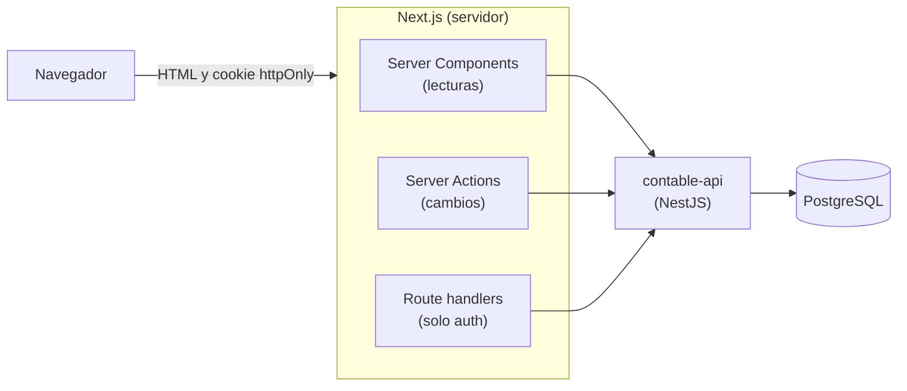

# contable-dashboard

Panel web para contadores argentinos: la cartera de clientes y los vencimientos impositivos de cada uno (IVA, Ganancias, Ingresos Brutos, Autónomos, Bienes Personales, Monotributo) en un solo lugar, con un resumen del estudio en la pantalla de inicio.

Es el frontend de [contable-api](https://github.com/LuisEdgardoCoronel/contable-api), una API REST en NestJS. Los dos proyectos forman un sistema multi-estudio: cada contador que se registra tiene su propio estudio, y solo ve sus datos.

**Lo más destacable:**

- **El navegador nunca llama a la API.** Todo pasa por el servidor de Next, y el JWT vive en una cookie `httpOnly` que JavaScript no puede leer.
- **Tipos generados desde el OpenAPI de la API:** si la API cambia, TypeScript marca lo que hay que tocar.
- **Tests end-to-end que comparan contra la API real:** las cifras de la pantalla se verifican contra lo que devuelve la API en ese momento.
- **Pensado para el celular y con tema oscuro**, que sigue la preferencia del sistema.
- **Funciona sin JavaScript** en los caminos principales: navegar, filtrar, paginar y enviar formularios.

## Funcionalidades

- **Inicio:** tarjetas con clientes activos y vencimientos pendientes, vencidos, presentados y de los próximos 30 días (cada una lleva a su listado), y dos gráficos: vencimientos por mes y por impuesto, con un rango de fechas configurable.
- **Clientes:** listado paginado con búsqueda por razón social o CUIT y filtro por activos o dados de baja. Alta y edición con validación de CUIT (dígito verificador), baja y reactivación, y creación del acceso de solo lectura para el cliente.
- **Vencimientos:** listado con pestañas (Vencidos, Pendientes, Próximos 30 días, Presentados, Todos) y su cantidad, filtros por cliente, impuesto y rango de fechas. Alta con el período validado según el impuesto (`AAAA-MM` o `AAAA`), marcado como presentado con fecha (o con la de hoy, desde el mismo listado), vuelta a pendiente, cambio de la fecha de vencimiento, notas y borrado. Los presentados después de su vencimiento se marcan como "Tarde".
- **Registro e inicio de sesión:** cualquiera puede registrarse y obtiene un estudio vacío. El panel es solo para contadores: un usuario cliente no puede entrar.
- **Celular y escritorio:** las tablas pasan a tarjetas en pantallas chicas, y la pestaña activa siempre queda a la vista.
- **Tema claro y oscuro**, según la preferencia del sistema.
- **Funciona sin JavaScript** en los caminos principales: navegar, filtrar, paginar y enviar formularios válidos.

## Stack

| Área | Tecnología |
|---|---|
| Framework | Next.js 16 (App Router, Cache Components, Server Actions) |
| UI | React 19, Tailwind CSS 4, shadcn/ui (sobre Base UI), Recharts |
| Lenguaje | TypeScript (modo estricto) |
| Tipos de la API | Generados desde el OpenAPI de la API con `openapi-typescript` |
| Tests | Vitest (unitarios), Playwright (end-to-end) |
| Runtime | Node.js 26 |

## Arquitectura



**El navegador nunca llama a la API.** Todas las requests a contable-api salen del servidor de Next:

- **Lecturas:** los Server Components piden los datos y devuelven la página ya armada.
- **Cambios:** los formularios usan Server Actions.
- **Autenticación:** unos pocos route handlers (login, registro, logout) hablan con la API y manejan la cookie.

Por qué así:

- **El token nunca llega a JavaScript.** El JWT vive en una cookie `httpOnly`, así que un script inyectado en la página no lo puede leer. No hay token en `localStorage`.
- **No hace falta CORS.** El navegador solo habla con el origen del panel.
- **La API puede quedar en una red privada.** No necesita estar expuesta a internet para que el panel funcione.
- **Un solo lugar maneja los errores.** Mensajes, timeouts y sesiones vencidas se resuelven en el servidor, en un cliente HTTP compartido (`src/lib/api/client.ts`).

El costo de este enfoque es que todos los logins le llegan a la API desde la IP del servidor de Next, lo que afecta al rate limit del login (ver [Limitaciones conocidas](#limitaciones-conocidas)).

### Estructura

```
src/
├── app/
│   ├── (panel)/          # rutas con sesión: inicio, clientes, vencimientos
│   ├── api/auth/         # route handlers: login, registro, logout, salir
│   ├── login/  registro/
│   └── layout.tsx
├── components/           # por pantalla (inicio, clientes, vencimientos) + ui de shadcn
├── lib/
│   ├── api/              # cliente HTTP, tipos generados (schema.d.ts) y alias legibles
│   ├── auth/             # cookie de sesión, JWT, rutaSegura
│   ├── fechas.ts         # fechas YYYY-MM-DD sin pasar por Date
│   └── clientes.ts, vencimientos.ts, …   # lógica pura: filtros, URLs, validación (con tests)
├── proxy.ts              # redirige según haya sesión o no
└── instrumentation.ts    # valida las variables de entorno al arrancar
e2e/                      # tests de Playwright
```

## Cómo correrlo en local

### Requisitos

- Node.js 26 o superior (hay un archivo `.node-version`).
- [contable-api](https://github.com/LuisEdgardoCoronel/contable-api) corriendo en `http://localhost:3000`, con las migraciones, el seed de impuestos y el estudio de demo (`npm run seed:demo`). Su README explica cómo levantarla con Docker.

### Pasos

1. Clonar e instalar dependencias:

   ```bash
   git clone https://github.com/LuisEdgardoCoronel/contable-dashboard.git
   cd contable-dashboard
   npm install
   ```

2. Crear el archivo de entorno:

   ```bash
   cp .env.example .env.local
   ```

   Tiene una sola variable, `API_URL=http://localhost:3000`. El servidor no arranca si falta o no es una URL http(s).

3. Arrancar en modo desarrollo:

   ```bash
   npm run dev
   ```

   El panel queda en [http://localhost:3001](http://localhost:3001) (el 3000 es de la API).

### Credenciales de demo

`seed:demo`, en la API, crea un estudio con 5 clientes (uno dado de baja) y vencimientos con fechas relativas a hoy, así que siempre hay pendientes, vencidos, presentados y próximos:

| Usuario | Email | Contraseña |
|---|---|---|
| Contador (entra al panel) | `demo@example.com` | `demo1234` |
| Cliente (no entra al panel: el login responde "Este panel es solo para contadores") | `cliente.demo@example.com` | `demo1234` |

También podés registrarte desde `/registro`. Vas a tener un estudio nuevo y vacío.

### Scripts

| Script | Qué hace |
|---|---|
| `npm run dev` | Servidor de desarrollo en el puerto 3001 |
| `npm run build` / `npm start` | Build de producción y servidor de producción (puerto 3001) |
| `npm run lint` | ESLint |
| `npm run types` | Regenera `src/lib/api/schema.d.ts` desde `http://localhost:3000/docs-json` (con la API arriba) |
| `npm test` | Tests unitarios (Vitest) |
| `npm run test:e2e` | Tests end-to-end (Playwright) contra `next dev` |
| `npm run test:e2e:prod` | Los mismos tests end-to-end contra un build de producción |

## Tests

### Unitarios

```bash
npm test
```

Cubren la lógica pura:

- el parseo de filtros y la construcción de URLs de los listados;
- la validación de formularios y de CUIT;
- las fechas (incluido el borde de medianoche en Argentina);
- la decodificación del JWT y `rutaSegura`.

Además, un chequeo verifica que cada página del panel declare cómo se renderiza.

### End-to-end

Corren en Chromium contra la API local con los datos de `seed:demo`. Necesitan:

1. **La API corriendo** con `seed:demo` cargado.
2. **Un `LOGIN_RATE_LIMIT` alto en el `.env` de la API** (por ejemplo, `100`), y la API reiniciada. La suite hace varios logins, y con el default de 5 por minuto recibe un 429. Si pasa, el error lo explica.
3. **Un `.env.test`**, copiado de `.env.test.example`. Tiene la URL de la API y las credenciales de demo; no hace falta cambiar nada.

```bash
npm run test:e2e        # contra next dev (levanta uno en el 3001, o reusa el que esté corriendo)
npm run test:e2e:prod   # contra next build + next start (el puerto 3001 tiene que estar libre)
```

Qué cubren:

- **Flujos completos:** login, registro, logout, tokens vencidos o inválidos, alta, edición, baja y reactivación de clientes, alta, presentación, notas y borrado de vencimientos, filtros y paginación.
- **Datos contra la API:** las cifras del Inicio y de las pestañas se comparan contra lo que devuelve la API en ese momento, no contra números fijos.
- **Formularios sin JavaScript:** los envíos válidos funcionan.
- **Celular:** tarjetas en lugar de tablas, sin scroll horizontal de la página.
- **Tema claro y oscuro.**
- **Ninguna request del navegador va a la API:** si alguna sale, el test falla.

Los tests que modifican datos usan un estudio propio que se registra en cada corrida (`e2e-…@example.com`), así que no tocan los datos de demo.

### En Windows

Corré Vitest desde una ruta con la unidad en mayúscula (`C:\…`). Si la terminal arranca en `c:\…`, todas las suites fallan con `Cannot read properties of undefined (reading 'config')`.

## Decisiones técnicas principales

- **La sesión, en una cookie `httpOnly`** (`SameSite=Lax`, `Secure` en producción), que dura lo mismo que el JWT.
  - El `proxy.ts` de Next lee el vencimiento del token sin verificar su firma y manda a `/login` si no hay sesión. La validez real del token la decide siempre la API.
  - Si la API rechaza un token, cualquier página redirige a una ruta que borra la cookie y vuelve al login.
- **Redirecciones seguras después del login.** El destino (`?next=`) solo acepta rutas internas: nada que empiece con `//` o `/\`, así no se puede usar para mandar al usuario a otro sitio.
- **Tipos generados, no escritos a mano.** `schema.d.ts` sale del OpenAPI de la API, y `types.ts` define alias legibles (`Cliente`, `Vencimiento`, `Paginado<T>`) a partir de él. Si la API cambia, se regeneran los tipos y TypeScript marca lo que hay que tocar.
- **Las fechas, como texto.** La API manda fechas `YYYY-MM-DD`, que se formatean directamente, sin pasarlas por `new Date()`: medianoche UTC es el día anterior en Argentina. "Hoy" se calcula en la zona `America/Argentina/Buenos_Aires`.
- **El estado de un vencimiento lo decide la API.** "Vencido" no se guarda: es un pendiente con fecha pasada. El panel muestra siempre el `estadoActual` que manda la API y nunca lo recalcula, así los números coinciden con los de la API.
- **Filtros y página en la URL.** Se pueden compartir, sobreviven a una recarga y funcionan con atrás y adelante. Los parámetros se validan, y los inválidos vuelven al valor por defecto.
- **Formularios con Server Actions:**
  - Validan en el servidor con las mismas reglas que la API, y muestran los errores debajo de cada campo, accesibles con `aria-invalid` y `aria-describedby`.
  - Los errores de validación de la API pueden venir en inglés: se muestran como "Revisá los datos". Los conflictos (un CUIT duplicado, por ejemplo) muestran el mensaje de la API, que viene en español.
  - Los avisos de éxito y las confirmaciones (dar de baja, borrar) viajan en la URL, así funcionan sin JavaScript.
- **Una sola llamada para el Inicio.** Tarjetas y gráficos salen de `GET /estadisticas`. Las cantidades de las pestañas de vencimientos salen de la misma llamada, en paralelo con el listado.
- **Accesibilidad:**
  - Los colores de estado están inspirados en la paleta Okabe-Ito, que se distingue con daltonismo, y el color nunca es la única pista: siempre hay texto.
  - La pestaña y la sección actuales llevan `aria-current`.
  - Los `<select>` son nativos.
  - El foco se ve siempre.
- **Render bloqueante en el servidor.** Las páginas con sesión esperan a tener los datos antes de responder, en lugar de mostrar un esqueleto y completarlo después. Así las redirecciones de autenticación son predecibles, y un test falla si una página nueva se olvida de declararlo.

## Limitaciones conocidas

- **Sin JavaScript, los errores de los formularios no se ven en producción.** Los envíos válidos funcionan, pero uno inválido vuelve al formulario vacío y sin mensajes (en desarrollo sí se ven). La causa está en cómo Next 16 arma el HTML de una Server Action con Cache Components, y no tiene una solución sin desactivar Cache Components. Con JavaScript, los errores se ven siempre.
- **Algunos status HTTP cambian en producción.** Un id inexistente muestra "no encontrado" con status 200 en lugar de 404, y un token rechazado por la API redirige al login desde el navegador en lugar de con un 307. La pantalla que ve el usuario es la correcta.
- **El rate limit del login se comparte.** La API limita los logins por IP, pero como todos le llegan desde el servidor de Next, el límite es compartido por todos los usuarios. Hay que resolverlo antes de publicar el panel, por ejemplo reenviando la IP real en un header que la API solo acepte del panel.
- **Registro abierto.** No tiene captcha, verificación de email ni límite de intentos.
- **Sin recuperación de contraseña** ni refresh tokens: la sesión dura lo que dura el JWT (un día, por defecto).
- **Un contador por estudio.** No hay usuarios con distintos permisos dentro de un mismo estudio.
- **Los tests end-to-end dejan datos.** Cada corrida registra un estudio `e2e-…@example.com` en la base local, que no se borra solo.
- **Todavía no está publicado.** Por ahora se corre en local. El plan del deploy en Railway está en [`docs/plan-deploy.md`](docs/plan-deploy.md).

## Licencia

[MIT](LICENSE).
